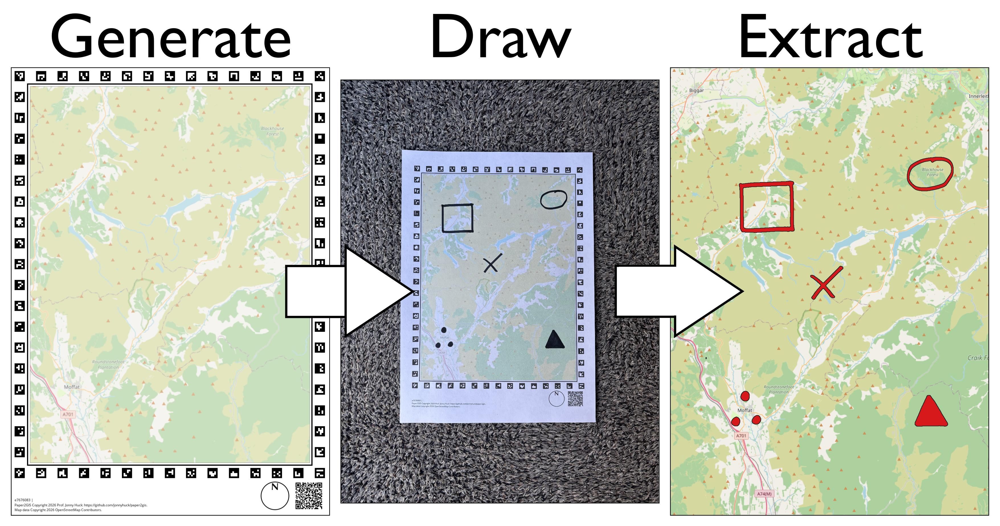
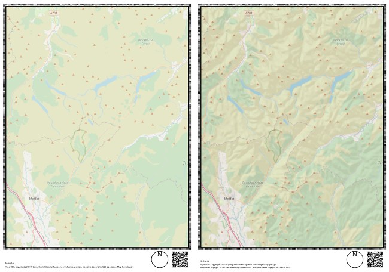
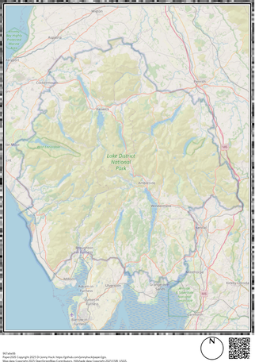

# Paper2GIS

Paper2GIS is a participatory GIS / mapping platform that allows participants to draw markup onto a paper map (using a **thick black marker pen**), which can then be automatically extracted into georeferenced Shapefile or GeoTiff datasets. This is intended to reduce the impact of *digital divides* on the collection of participatory map data. Paper2GIS was created in 2016 for students to use on a field course in the Indian Himalaya. It has since been used for a range of teaching and research applications, some of which are listed in the [References](#references) section of this document. 

The basics of the extraction workflow is illustrated below: you simply generate a map, draw on it and take a photograph, then pass the photograph back to the software to extract it either to a Shapefile or a GeoTiff (Shapefile shown).



## Contents:

* [Notes](#notes)
  * [Notes on map generation](#notes-on-map-generation)
  * [Notes on map extraction](#notes-on-map-extraction)

* [Usage](#usage)
* [Installation](#installation)
  * [Mac](#mac)
  * [Ubuntu](#ubuntu)
  * [Windows](#windows)

* [Updating Paper2GIS](#updating-paper2gis)
* [Bulk Operations and Python Interface](#bulk-operations-and-python-interface)
* [Future Development](#future-development)
* [Licensing](#licensing)
* [References](#references)

## Notes

### Notes on Map Generation

Paper2GIS no longer supports map generation using Mapnik Stylesheets, as the Mapnik [Python Bindings](https://github.com/mapnik/python-mapnik) proved to be increasingly challenging for people to build and appear to have very limited support / development at the moment. Instead, you can now either:

* provide a map image that will be used instead. I would recommend making your map **1003 x 1348 px** for a portrait layout or **1468 x 883 px** for a landscape layout (or **1087 x 1432** / **1552 x 967** if using `--no_markers). Please ensure that there are no very dark areas (e.g. prominent black labels), which may be misinterpreted as markup. 
* provide your desired map bounds and Paper2GIS will generate a map for you using map tiles (OpenStreetMap, or Google / ESRI satellite imagery). You control the desired zoom level of the map tiles that it uses to make sure that you get the desired effect. To get an idea, if you go to [OpenStreetMap](https://www.openstreetmap.org/), you can see the zoom level currently visible on the screen by looking at the URL. For example, if the URL is `https://www.openstreetmap.org/#map=18/2.78882/32.29586`, then the zoom level is **18** (the number that immediately follows `#map=`). The range is between `0` (for the whole world on a single tile) and `19` (the finest level of detail).
* If you are using a tiles option, you can add an optional **hillshade layer** courtesy of ESRI. An example of a Paper2GIS map with and without hillshade is given below:



* If you are using the tiles option, you also have the option of adding a boundary to your dataset (i.e., to mark the extent of your are of interest). This is achieved by providing a path to a Shapefile containing the boundary as a polygon. It will be drawn as an outline, with the width, colour and opacity all editable using the options. An example of a Paper2GIS map with a Shapefile boundary is given below (blue boundary around the national park):

  

By default, the map is surrounded by a ring of [ArUco markers](https://docs.opencv.org/4.x/d5/dae/tutorial_aruco_detection.html) (small black and white squares, each with a unique ID). This was the approach that Paper2GIS originally used in 2016, and was reintroduced in 2026.  These allow the extraction process to locate the map in the photograph precisely, with out needing to be able to identify features in the map itself (which can be challenging in some cases, e.g., satellite imagery that is mostly forest and so has few distinctive features). If you want to generate a map using the older layout (with a random noise border, rather than the ArUco markers), you can use `--no_markers`. The `extract` software is (and will remain) compatible with both options. 

It is always good to thoroughly test a map using the extractor before using a Paper2GIS layout 'in the wild', and remember that the `extract` software has lots of settings to help make sure that you get a nice result, so don't panic if you don't get a perfect result first time with the default settings!

### Notes on Map Extraction

Markup can be extracted as-is (marked areas will become **polygons**), as **convex hulls**, as **centroids** (point representing the geometric centroid, irrespective of whether or not it is contained within the original polygon), as **representative points** (point that is definitely inside the original polygon) or as **polygons from boundaries** (where only the boundary is marked on the map, but a filled polygon is extracted using either the exterior interior ring(s)). All extraction can be in the form of either a ShapeFile (`.shp`) or GeoTiff (`.tif`).

To locate the map in the photograph, the extractor first looks for the ArUco markers around the map. If the layout does not have them (i.e., it was made with an older version of Paper2GIS or with `--no_markers`), or not enough of them can be found, it falls back to matching features (SIFT) in the map itself. There are several options to tune this fallback (`--magsac`, `--downscale`, `--max_features`), see below. Once the map is located, the extractor reads the QR code in the photograph and stops with an error if it does not match the reference image, as you are probably using the wrong reference image. This is important because the markers are the same on every layout, so a photograph of one map will line up perfectly with the reference image for a different map, giving a wrong result. The ID is calculated from the settings that define the map (its extent, CRS, layout and tile settings, or the input map image), so regenerating a layout with exactly the same settings gives the same ID and is fine to use as the reference. If you are sure that it is the same map but the IDs differ (e.g., it was made with an older version of Paper2GIS, which used random IDs), use `--ignore_qr` to continue anyway. If the QR code cannot be read at all, a warning is printed.

## Usage

Paper2GIS is accessed via a Python-based CLI package (`p2g.py`), the basic functionality is explained with the commands below. On a Mac or Linux machine, these commands can simply be typed into the the **Terminal**. on Windows, these commands should be run in the **Anaconda Prompt**. 

Note that **Terminal** / **Anaconda Prompt** should be pointed to your `Paper2GIS` directory (i.e., the directory containing `p2g.py`) before running any of these commands. This can be achieved by running the command `cd <PATH_TO_Paper2GIS>` (e.g., `cd /Users/user/Paper2GIS/`).

To view the basic functionality of `p2g.py`, you can type the following command:

```bash
python p2g.py -h
```

Which returns:

```txt
usage: Paper2GIS [-h] {generate,extract,gcp,test} ...

positional arguments:
  {generate,extract,gcp,test}
                        either: 'generate' to make a Paper2GIS layout; 'extract' to retrieve markup from a
                        photograph of a used Paper2GIS layout; 'gcp' to retrieve markup using ground control
                        points (if extract cannot locate the map); or 'test' to test that a new installation
                        is functioning

options:
  -h, --help            show this help message and exit
```

This explains that there are four possible commands: `generate`, `extract`, `gcp` and `test`. Each is explained in more detail below.

### Create a Paper2GIS layout from a map image (`p2g.py generate`)

Before running any commands, you must activate the `paper2gis` environment:

```bash
conda activate paper2gis
```

Example call with a pre-existing map (`1003 x 1348px @ 96dpi`):

```bash
python p2g.py generate -a -2462672.600 -b 9330748.585 -c -2393838.600 -d 9421934.585
```

Example call with a map drawn using OSM tiles (zoom level 10):

```bash
python p2g.py generate -a -2462672.600 -b 9330748.585 -c -2393838.600 -d 9421934.585 -o test2.png -t -z 10
```

or with ESRI or Google satellite imagery tiles

```bash
python p2g.py generate -a -2462672.600 -b 9330748.585 -c -2393838.600 -d 9421934.585 -o test2.png -t esri -z 10
python p2g.py generate -a -2462672.600 -b 9330748.585 -c -2393838.600 -d 9421934.585 -o test2.png -t google -z 10
```

Layouts are portrait by default. For a landscape layout, add the `-ls` or `--landscape` flag:

```bash
python p2g.py generate -a -2462672.600 -b 9330748.585 -c -2393838.600 -d 9421934.585 -o test2.png -t -z 10 -ls
```

To enable verbose output showing detailed progress information, add the `-v` or `--verbose` flag:

```bash
python p2g.py generate -a -2462672.600 -b 9330748.585 -c -2393838.600 -d 9421934.585 -o test2.png -t -z 10 -v
```

Full details:

```
usage: Paper2GIS generate [-h] -a BL_X -b BL_Y -c TR_X -d TR_Y [-e EPSG] [-r RESOLUTION] [-i INPUT] [-o OUTPUT] [-n DESCRIPTION]
                          [-t [{osm,esri,google}]] [-f FADE] [-z ZOOM] [-hs] [-sa HILLSHADEALPHA] [-bf BOUNDARYFILE] [-bw BOUNDARYWIDTH]
                          [-bc BOUNDARYCOLOUR] [-ba BOUNDARYALPHA] [-ls] [-nm] [-v]

options:
  -h, --help            show this help message and exit
  -a BL_X, --bl_x BL_X  bottom left x coord
  -b BL_Y, --bl_y BL_Y  bottom left y coord
  -c TR_X, --tr_x TR_X  top right x coord
  -d TR_Y, --tr_y TR_Y  top right y coord
  -e EPSG, --epsg EPSG  EPSG code for the map CRS
  -r RESOLUTION, --resolution RESOLUTION
                        Resolution of the input map image (dpi)
  -i INPUT, --input INPUT
                        the input map image (file path) - this is ignored if --tiles is used
  -o OUTPUT, --output OUTPUT
                        the output data file (file path)
  -n DESCRIPTION, --description DESCRIPTION
                        Descriptive text that will be printed on the map
  -t [{osm,esri,google}], --tiles [{osm,esri,google}]
                        create a map from tiles: 'osm' (OpenStreetMap, the default if no value is given), 'esri' (ESRI satellite imagery) or
                        'google' (Google satellite imagery) - ignores --input
  -f FADE, --fade FADE  intensity of the white filter over the tiles (0-255)
  -z ZOOM, --zoom ZOOM  requested zoom level of the tiles (necessary if using tiles)
  -hs, --hillshade      add hillshade to generated OSM map
  -sa HILLSHADEALPHA, --hillshadealpha HILLSHADEALPHA
                        the alpha value for the hillshade layer
  -bf BOUNDARYFILE, --boundaryfile BOUNDARYFILE
                        a shapefile containing boundary data
  -bw BOUNDARYWIDTH, --boundarywidth BOUNDARYWIDTH
                        the width (in pixels) of the boundary line
  -bc BOUNDARYCOLOUR, --boundarycolour BOUNDARYCOLOUR
                        the colour of the boundary line
  -ba BOUNDARYALPHA, --boundaryalpha BOUNDARYALPHA
                        the alpha (opacity) of the boundary line
  -ls, --landscape      make an A3 landscape layout (default is A3 portrait)
  -nm, --no_markers     use the old random noise border instead of ArUco markers (gives a slightly larger map)
  -v, --verbose         enable verbose output
```

### Extract markup from an image of a used Paper2GIS layout (`p2g.py extract`)

Before running any commands, you must activate the `paper2gis` environment:

```bash
conda activate paper2gis
```

Example call for extraction:

```
python p2g.py extract --reference map.png --target in.jpg -o out.shp --threshold 100 --kernel 0
```

To enable verbose output showing detailed progress information, add the `-v` or `--verbose` flag:

```
python p2g.py extract --reference map.png --target in.jpg -o out.shp --threshold 100 --kernel 0 -v
```

Full details:

```
usage: Paper2GIS extract [-h] -r REFERENCE -t TARGET [-l LOWE_DISTANCE] [-m HOMO_MATCHES] [-g] [-ds DOWNSCALE] [-mf MAX_FEATURES] [-f FRAME]
                         [-o OUTPUT] [-k KERNEL] [-i THRESHOLD] [-u UID] [-a MIN_AREA] [-x MIN_RATIO] [-b BUFFER] [-cc] [-cx] [-cr] [-ce] [-ci]
                         [-iq] [-d] [-v]

options:
  -h, --help            show this help message and exit
  -r REFERENCE, --reference REFERENCE
                        the reference image
  -t TARGET, --target TARGET
                        the target image
  -l LOWE_DISTANCE, --lowe_distance LOWE_DISTANCE
                        the lowe distance threshold
  -m HOMO_MATCHES, --homo_matches HOMO_MATCHES
                        the number of matches required for homography
  -g, --magsac          use MAGSAC rather than RANSAC to calculate the homography (more tolerant of bad matches)
  -ds DOWNSCALE, --downscale DOWNSCALE
                        shrink the photo to this multiple of the reference size for SIFT matching (0 to disable)
  -mf MAX_FEATURES, --max_features MAX_FEATURES
                        the maximum number of SIFT keypoints to use in each image (0 for no limit)
  -f FRAME, --frame FRAME
                        a frame to add round the image if the map is too close to the edge
  -o OUTPUT, --output OUTPUT
                        the name of the output file
  -k KERNEL, --kernel KERNEL
                        the size of the kernel used for opening the image
  -i THRESHOLD, --threshold THRESHOLD
                        the threshold the target image
  -u UID, --uid UID     user ID number to add the the output shapefile
  -a MIN_AREA, --min_area MIN_AREA
                        the area below which features will be rejected
  -x MIN_RATIO, --min_ratio MIN_RATIO
                        the ratio (long/short) below which features will be rejected
  -b BUFFER, --buffer BUFFER
                        buffer around the edge used for data cleaning
  -cc, --convex_hull    store convex hulls of extracted shapes?
  -cx, --centroid       store centroids of extracted shapes?
  -cr, --representative_point
                        store representative points of extracted shapes?
  -ce, --exterior       extract polygons from boundaries by extracting the outer ring
  -ci, --interior       extract polygons from boundaries by extracting the inner rings
  -iq, --ignore_qr      continue (with a warning) if the QR code in the photograph does not match the reference image
  -d, --demo            write the intermediate images to ./demo
  -v, --verbose         enable verbose output
```

Note that the `-cc`, `-cx`, `-cr`, `-ce` and `-ci` parameters allow you to control what type of geometry output you get (without these, the markup is converted directly to polygons).

### Extract markup using ground control points (`p2g.py gcp`)

On the extremely rare occasion that `extract` cannot locate the map in a photograph for any reason (e.g., the photograph is very blurred, or it is an older layout without markers showing a map with few distinctive features), you can tell Paper2GIS where the map is by marking its four corners yourself, using the **Georeferencer** in QGIS:

1. In QGIS, open **Layer > Georeferencer** and open the photograph.
2. Use **Add Point** to add a point at each of the four corners of the map (the inside corners of the black line around the map), entering the map coordinates of that corner when QGIS asks for them. The corners can be added in any order - the map coordinates are used to work out which corner each point is, and to check that you are using the right reference image (the georeferencing itself comes from the reference image).
3. Save the points using **File > Save GCP Points as...**. By default, QGIS names the file after the photograph with `.points` on the end (e.g., `IMG_1.jpg.points`), which is where `gcp` looks for it by default.

Then run `gcp` with the reference image and the photograph, as you would for `extract`:

```
python p2g.py gcp --reference map.png --target IMG_9441.jpg -o out.shp
```

or, if the `.points` file has a different name:

```
python p2g.py gcp --reference map.png --target IMG_9441.jpg --points corners.points -o out.shp
```

The map can be at any orientation in the photograph (use `-v` to see which corner each point was identified as, or `-d` to write an image showing this). A warning is printed if the map coordinates in the `.points` file do not match the extent of the reference image. The markup is then extracted and cleaned in exactly the same way as `extract`, and the QR code check also applies. Note that QGIS ignores the rotation that phones store in photographs, so `gcp` does too, so that the points line up.

Full details:

```
usage: Paper2GIS gcp [-h] -r REFERENCE -t TARGET [-p POINTS] [-o OUTPUT] [-k KERNEL] [-i THRESHOLD] [-u UID] [-a MIN_AREA] [-x MIN_RATIO]
                     [-b BUFFER] [-cc] [-cx] [-cr] [-ce] [-ci] [-iq] [-d] [-v]

options:
  -h, --help            show this help message and exit
  -r REFERENCE, --reference REFERENCE
                        the reference image
  -t TARGET, --target TARGET
                        the target image
  -p POINTS, --points POINTS
                        the QGIS .points file containing the four corners of the map (default: the target file name + .points)
  -o OUTPUT, --output OUTPUT
                        the name of the output file
  -k KERNEL, --kernel KERNEL
                        the size of the kernel used for opening the image
  -i THRESHOLD, --threshold THRESHOLD
                        the threshold the target image
  -u UID, --uid UID     user ID number to add the the output shapefile
  -a MIN_AREA, --min_area MIN_AREA
                        the area below which features will be rejected
  -x MIN_RATIO, --min_ratio MIN_RATIO
                        the ratio (long/short) below which features will be rejected
  -b BUFFER, --buffer BUFFER
                        buffer around the edge used for data cleaning
  -cc, --convex_hull    store convex hulls of extracted shapes?
  -cx, --centroid       store centroids of extracted shapes?
  -cr, --representative_point
                        store representative points of extracted shapes?
  -ce, --exterior       extract polygons from boundaries by extracting the outer ring
  -ci, --interior       extract polygons from boundaries by extracting the inner rings
  -iq, --ignore_qr      continue (with a warning) if the QR code in the photograph does not match the reference image
  -d, --demo            write the intermediate images to ./demo
  -v, --verbose         enable verbose output
```

### Verify an installation (`p2g.py test`)

To test than an installation works, the easiest approach is to simply run the following commands in your **Terminal** (Linux/Mac) or **Anaconda Prompt** (Windows). This runs a simple test that will complete an image extraction of the markup on `test/target.png` and tell you how different it is to the reference version at `test/out.png` (the value should be close to 0%).

Note that **Terminal** / **Anaconda Prompt** should be pointed to your `Paper2GIS` directory (i.e., the directory containing `p2g.py`) before running any of these commands. This can be achieved by running the command `cd <PATH_TO_Paper2GIS>` (e.g., `cd /Users/user/Paper2GIS/`).

```bash
conda activate paper2gis
python p2g.py test
```

Which, if successful, will return something like (the percentage might vary slightly between platforms):

```txt
Running test image generation...
Generation works!
The result is 14.50% different to the reference version (up to 15% is due to the random border).


Running test image extraction...
Extraction works!
The result is 0.00% different to the reference version.
```

## Installation

The below examples use conda to manage the Python installations, but there is no reason that you could not do this with `pip`,  `virtualenv`, or any other similar package management / virtual environment system.

### Mac

Open **Terminal** and run through the following steps:

* Install X Code tools:

```bash
xcode-select --install
```

* Install Homebrew:

```
/bin/bash -c "$(curl -fsSL https://raw.githubusercontent.com/Homebrew/install/HEAD/install.sh)"
```

* Install C library dependencies:

```bash
brew install zbar opencv gdal geos imagemagick
```

* **(Only if you do not already have it installed)** [Install Miniconda / Anaconda](https://docs.conda.io/projects/continuumio-conda/en/latest/user-guide/install/macos.html)

* Set up conda environment (note the need to use `pip` for `opencv-contrib-python`):

```bash
conda create -n paper2gis -c conda-forge -y python=3 numpy=1.26.4 fiona rasterio pyzbar qrcode pillow cartopy pillow-heif
conda activate paper2gis
pip install opencv-contrib-python
```

* Get Paper2GIS:

```bash
git clone https://github.com/jonnyhuck/Paper2GIS
cd Paper2GIS
```

At this point, you should have a working installation that you can test with the following command:

```bash
python p2g.py test
```

Which, if successful, will return something like (the percentage might vary slightly between platforms):

```txt
Running test image generation...
Generation works!
The result is 14.50% different to the reference version (up to 15% is due to the random border).


Running test image extraction...
Extraction works!
The result is 0.00% different to the reference version.
```

### Ubuntu

Open **Terminal** and run through the following steps:

* Install C library dependencies:

```bash
sudo apt install libopencv-dev python3-opencv libgdal-dev gdal-bin libzbar0 libgeos3.10.2
```

* **(Only if you do not already have it installed)** [Install Miniconda / Anaconda](https://docs.conda.io/projects/continuumio-conda/en/latest/user-guide/install/linux.html)

* Set up conda environment (note the need to use `pip` for `opencv-contrib-python`):

```bash
conda create -n paper2gis -c conda-forge -y python=3 numpy=1.26.4 fiona rasterio pyzbar qrcode pillow cartopy pillow-heif
conda activate paper2gis
pip install opencv-contrib-python
```

* Get Paper2GIS:

```bash
git clone https://github.com/jonnyhuck/Paper2GIS
cd Paper2GIS
```

At this point, you should have a working installation that you can test with the following command:

```bash
python p2g.py test
```

Which, if successful, will return something like (the percentage might vary slightly between platforms):

```txt
Running test image generation...
Generation works!
The result is 14.50% different to the reference version (up to 15% is due to the random border).


Running test image extraction...
Extraction works!
The result is 0.00% different to the reference version.
```

### Windows

* Install the **Visual C++ Redistributable Packages** from [here](https://www.microsoft.com/en-US/download/details.aspx?id=40784). Note that you need to select the version that best suits your system: `vcredist_x64.exe` for 64 bit systems, `vcredist_x86.exe` for 32 bit systems, or `vcredist_arm.exe` for arm-based systems. If you are not sure and are using a relatively 'standard' laptop, it is likely that the one you need will be `vcredist_x64.exe`.
* Install GEOS and GDAL:

Download the [OSGeo4W Network Installer](https://trac.osgeo.org/osgeo4w/), run it and select **Advanced Install** &rarr; **Install from the Internet** and the accept the defaults on the **Select Root install Directory**, **Set Local Package Directory** and **Select your Internet Connection** pages. When you are asked to **Choose a Download Site**, choose the top option in the list.

Now, will be looking at a long list of things that you can install. Expand the **Libraries** and select the following options by clicking once on the **Skip** label next to the following (this changes it from Skip to the current version): 

* gdal: The GDAL/OGR library and commandline tools
* geos: The GEOS geometry library (Runtime)

Now click **Next** and the software will present you with a longer list of software that comprises the dependencies of your selected packages. Make sure the **Install these packages to meet dependencies** box at the bottom is ticked and click **Next**. The download process will begin and you may be presented with one or more license agreements that you must **Agree** before proceeding. When the **Installation Complete** message appears, click **Finish**.

* **(Only if you do not already have it installed)** [Install Miniconda / Anaconda](https://docs.conda.io/projects/continuumio-conda/en/latest/user-guide/install/windows.html)

Now, open **Anaconda Command Prompt** and run through the remaining steps:

* Create the `paper2gis` Anaconda Environment

<!-- NOTE!: THE WINDOWS INSTALL COMMAND IS DIFFERENT TO THE OTHERS - PYZBAR NEEDS TO BE INSTALLED FROM PIP -->
```bash
conda create -n paper2gis -c conda-forge -y python=3 numpy=1.26.4 fiona rasterio qrcode pillow cartopy pillow-heif
conda activate paper2gis
pip install opencv-contrib-python pyzbar
```

* Get Paper2GIS:
**Note:** If the below command (starting `git...`) doesn't work, this could be because the `git` software is missing from your system. To fix this, you can install Git from [here](https://git-scm.com/downloads/win). Select the **Standalone Installer**, and choose the 32-bit or 64-bit version as required by your system (if you are not sure, you will most likely need 64-bit). You may need to close an re-open the **Anaconda Command Prompt** for the command to work.

```bash
git clone https://github.com/jonnyhuck/Paper2GIS
cd Paper2GIS
```

At this point, you should have a working installation that you can test with the following command:

```bash
python p2g.py test
```

Which, if successful, will return something like (the percentage might vary slightly between platforms):

```txt
Running test image generation...
Generation works!
The result is 14.50% different to the reference version (up to 15% is due to the random border).


Running test image extraction...
Extraction works!
The result is 0.00% different to the reference version.
```

## Updating Paper2GIS

Paper2GIS is updated from time to time. If you installed it with `git clone`, you can bring your copy up to date with the steps below. This takes about five minutes on a Mac or Windows machine.

### Before you start

You need:

- **Mac:** the **Terminal** app (Applications → Utilities).
- **Windows:** the **Anaconda Prompt** app (search for it in the Start menu). Note that this is not the ordinary Command Prompt or PowerShell window.
- To know where your `Paper2GIS` folder is: this is the one you downloaded when you installed Paper2GIS. It is the one containing `p2g.py`.

### Step 1: Go to your Paper2GIS folder

Open **Terminal** (Mac) or **Anaconda Prompt** (Windows) and move into your `Paper2GIS` folder with `cd`. Specific instructions are given below for **Mac** or **Windows**.

#### **Mac Instructions**

Paste the below command into **Terminal** and press **Enter**:

```
cd ~/Paper2GIS
```

If this didn't work, it means you have stored your Paper2GIS folder somewhere else. Type `cd ` (with a space at the end) and drag the `Paper2GIS` folder from Finder onto the **Terminal** window to populate the correct file path. Then press **Enter**.

Check you are in the right place by running the command `ls` to list all of the files in this directory. You should see `p2g.py` in the list of files that appears.

#### **Windows Instructions**

Paste the below command into **Anaconda Prompt** and press **Enter**:

```
cd /d %USERPROFILE%\Paper2GIS
```

If this didn't work, it means you have stored your Paper2GIS folder somewhere else. Type `cd /d ` (with a space at the end) and drag the `Paper2GIS` folder from File Explorer onto the **Anaconda Prompt** window. Then press **Enter**.

Check you are in the right place by running the command `dir` to list all of the files in this directory. You should see `p2g.py` in the list of files that appears.

### Step 2: Download the latest version

To update your version of Paper2GIS, paste in the below command and press **Enter** to run it. This command is the same on Mac and Windows:

```
git pull
```

You should see a list of changed files, or `Already up to date.` if you already had the latest version. In either case, this is fine.

Any message starting `error:` or `fatal:` means it did not work; see the [Troubleshooting](#troubleshooting) section below.

### Step 3: Check it works

Activate the Paper2GIS environment and run the built-in test with the following commands, which should be run one by one (the commands are the same on Mac and Windows):

```
conda activate paper2gis
python p2g.py test
```

It has worked if you see both `Generation works!` and `Extraction works!`, with the extraction result close to 0% different. The percentages may vary slightly between computers.

### Troubleshooting

Find the start of your error message in the left column. Commands are the same on Mac and Windows unless marked.

| Error message                                                | What it means                                                | Fix                                                          |
| ------------------------------------------------------------ | ------------------------------------------------------------ | ------------------------------------------------------------ |
| `fatal: not a git repository`                                | You are in the wrong folder, or you downloaded Paper2GIS as a ZIP rather than with `git clone` | Repeat Step 1 and check you can see `p2g.py`.                |
| Windows: `'git' is not recognized as an internal or external command` | Git is not installed                                         | Install Git from [git-scm.com/downloads/win](https://git-scm.com/downloads/win), close and reopen the Anaconda Prompt, then start again from Step 1 |
| Mac: `xcrun: error: invalid active developer path`           | Apple's developer tools (which include Git) are missing, often after a macOS update | Run `xcode-select --install`, follow the prompts, then run `git pull` again |
| `Your local changes to the following files would be overwritten by merge` | You have edited one of the Paper2GIS files                   | Run `git stash` to put your edits aside, then `git pull`     |
| `The following untracked working tree files would be overwritten by merge` | One of your own files has the same name as a new Paper2GIS file | Move the listed files out of the folder, then `git pull`     |
| `Need to specify how to reconcile divergent branches` or `Not possible to fast-forward` | Your copy has changes git cannot combine with the update     | Run `git fetch` then `git reset --hard origin/master`. This discards any edits to Paper2GIS files but keeps files you added |
| `EnvironmentNameNotFound`                                    | The `paper2gis` environment does not exist under that name   | Run `conda env list` to see your environments. If it is missing, follow the [installation](#installation) instructions above |
| Windows: `'conda' is not recognized`                         | You are in Command Prompt or PowerShell                      | Close it and open the **Anaconda Prompt** instead            |

## Bulk Operations and Python Interface

Paper2GIS does not currently have any specific bulk data processing functionality because of the wide variety of options that people might want to use. However, this can easily be achieved using Python by importing the relevant functionality from Paper2GIS into your own Python scripts. 

For example the below script generates a series of maps based on the content of a CSV file, which specifies any number of the parameters that you want to vary between the maps:

```csv
ID,Z,a,b,c,d,Name,Description
1,14,4141391,14169,4175808,59762,Map1,Il Ngewse and surrounding area
2,15,4152697,29782,4164886,45930,Map2,Il Ngwese
3,16,4152697,37856,4158791,45930,Map3,Il Ngewse north west area
4,16,4158791,37856,4164886,45930,Map4,Il Ngewse north east area
5,16,4158791,29782,4164886,37856,Map5,Il Ngewse south east area
6,16,4152697,29782,4158791,37856,Map6,Il Ngewse south west area
```

```python
from pandas import read_csv
from paper2gis.gis2paper import run_generate

# load instructions
maps = read_csv('generate_settings.csv')

# loop through each desired map
for idx, row in maps.iterrows():

    # generate map
    run_generate(row['a'], row['b'], row['c'], row['d'], epsg='3857', out_path=f"./{row['Name']}.png",
                 descriptive_text=row['Description'], tiles='google', fade=120, zoom=row['Z'], hillshade=True,
                 hillshade_alpha=0.3, boundary_file='./data/boundary.shp', boundary_width=8,boundary_colour='white',
                 boundary_alpha=0.6, verbose=True)

print('done')
```

Similarly, if you want to automate extraction, you can do so with something like this, again using a CSV file to set any combination of parameters that you like:

```csv
reference,target,output,thresh,min_area
./reference.jpeg, ./IMG1.png, IMG1.shp, 80, 11000 
./reference.jpeg, ./IMG2.png, IMG1.shp, 80, 15000
./reference.jpeg, ./IMG3.png, IMG1.shp, 90, 1300
./reference.jpeg, ./IMG4.png, IMG1.shp, 80, 1000
```

```python
from pandas import read_csv
from paper2gis.paper2gis import run_extract

# load instructions
settings = read_csv('extract_settings.csv')

# loop through each desired map
for idx, row in maps.iterrows():

    # generate map
    run_generate(row['reference'], row['target'], row['output'], threshold=row['reference'], 
                 min_area=row['reference'], verbose=True)

print('done')
```

A similar effect can also be achieved using a simple shell script, such as the below:

```bash
#!/bin/bash

# this prevents an error for loops that match no file
shopt -s nullglob
 
# loop through all of the .jpg files
for FILE in *.jpg 
do

    # print name of current file
    echo $FILE

    # run the extractor (and print the command to the console)
    FILENEW=`echo $FILE | sed "s/.jpg/.shp/"`
    echo python ../p2g.py extract --reference ../out.png --target $FILE -o $FILENEW
    python ../p2g.py extract --reference ../out.png --target $FILE -o $FILENEW
    echo ""
done

# unset shell option again
shopt -u nullglob

echo "done."
```

## Future Development:

I am planning to add the following features to Paper2GIS:

* Improved output cleaning for GeoTiff outputs (so that it is the same as for the Shapefile outputs)
* Handle polygons with holes in when using boundary generator
* Improve handling of boundary polygons that intersect the edge of the map
* The ability to draw maps from custom tile sources
* Automated histogram stretch for input images to improve definition of markup
* A QGIS Plugin to interface with Paper2GIS

If you would like to request a feature (or wish for one to be prioritised), you can do so by opening an [Issue](https://github.com/jonnyhuck/Paper2GIS/issues).

## Licensing

The software is licensed under the [GNU General Public License v3](LICENSE). Bundled within it is the Open Sans font, which is licensed under the [Apache License v2](resources/Apache_License.txt).

## References

Paper2GIS has been described in the following articles in the academic literature (* = open access):

### Journal Articles

[Denwood, T., Huck, J. J., & Lindley, S. (2022). Paper2GIS: improving accessibility without limiting analytical potential in Participatory  Mapping. *Journal of Geographical Systems*, 1-21.](https://link.springer.com/article/10.1007/s10109-022-00386-6) *

[Panek, J., Hennig, B., Huck, J. & Benediktsson, K. (2023) Geospatial technologies in hazard research and response – a case study of Paper2GIS in an international field course. Journal of Geography in Higher Education.](https://www.tandfonline.com/doi/full/10.1080/03098265.2023.2263750)

### Conference Papers

[Huck, J. J., Dunning, I., Lee, P., Lowe, T., Quek, E., Weerasinghe, S.,  & Wintie, D. (2017). Paper2GIS: a self-digitising,  paper-based PPGIS. In *Geocomp 2017: Proceedings of the 14th International Conference on Geocomputation*.](https://www.geog.leeds.ac.uk/groups/geocomp/2017/papers/80.pdf) *

[Denwood, T., Huck, J.J., & Lindley, S. (2021). Paper2GIS: Going postal in the midst of a pandemic. In *Proceedings of the 29th Geographical Information Science UK Conference*.](https://zenodo.org/record/4665392) *